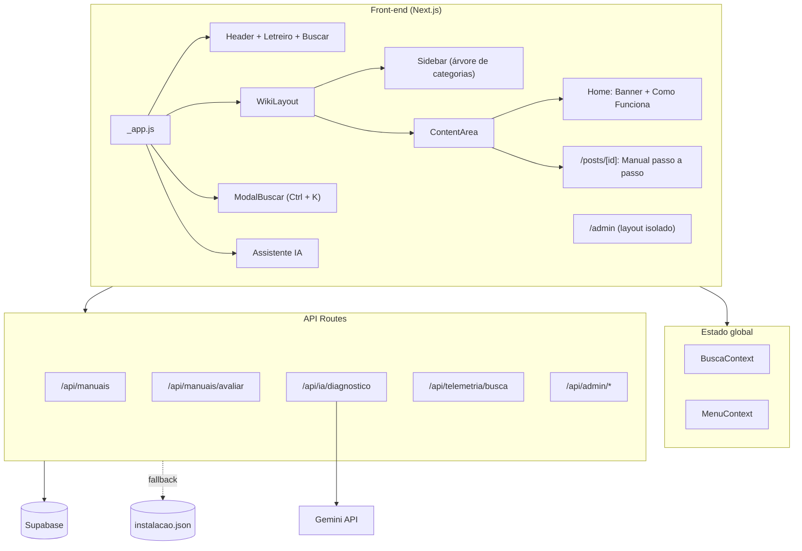

# N1 GuidePro

Base de conhecimento interna para equipes de **suporte técnico N1**, com navegação no estilo **Wiki.js**, busca rápida, manuais passo a passo e um **Assistente de IA** (Google Gemini) que localiza manuais ou gera novos procedimentos sob demanda. 🚀

---

## 🌐 Sobre o Projeto

O **N1 GuidePro** centraliza manuais práticos, fluxos de atendimento e procedimentos padronizados para o dia a dia do help desk. O analista navega pela árvore de categorias na lateral, pesquisa com `Ctrl + K`, segue o passo a passo e copia o procedimento já formatado para colar no chamado.

### Principais recursos

- **Layout estilo Wiki.js** — Header fixo, Sidebar em árvore (categorias → manuais) com contador, destaque do manual ativo, modo recolhido e drawer no mobile.
- **Busca rápida global** — Atalhos `Ctrl + K` / `/`, botão **Buscar** no Header e no Banner; os resultados abrem em uma gaveta lateral (fecha com `Esc` ou clicando fora).
- **Manuais passo a passo** — Breadcrumb (`Categoria › Manual`), detecção automática de URLs, comandos e caminhos em blocos copiáveis (`RichText`), imagens por passo.
- **Copiar para o Chamado** — Gera o procedimento formatado em texto, pronto para o ticket.
- **Avaliação de utilidade** — Votos 👍 / 👎 e contagem de visualizações por manual.
- **Assistente IA (Gemini)** — Diagnostica o problema descrito, pede mais detalhes quando a descrição é vaga, sugere manuais existentes ou gera um passo a passo novo, que pode ser enviado para moderação.
- **Painel de Moderação (`/admin`)** — Aprovar, editar ou recusar manuais gerados pela IA, além de dashboard com métricas (mais acessados, taxa de resolução, buscas sem manual correspondente).
- **Fallback offline** — Se o Supabase estiver indisponível, os dados são lidos de `src/data/instalacao.json`.

---

## 🛠️ Tecnologias

| Camada | Tecnologia |
| :--- | :--- |
| Framework | [Next.js 14](https://nextjs.org/) (Pages Router, SSG + ISR e API Routes) |
| UI | [React 18](https://react.dev/) + [Styled-Components 6](https://styled-components.com/) (compilador SWC) |
| Ícones | [React Feather](https://github.com/feathericons/react-feather) |
| Banco de dados | [Supabase](https://supabase.com/) (PostgreSQL) |
| IA | [Google Gemini API](https://ai.google.dev/) |
| Observabilidade | Vercel Analytics + Speed Insights |
| Deploy | [Vercel](https://vercel.com/) |

---

## 🧭 Arquitetura



---

## 📂 Estrutura do Projeto

```
n1_guide_pro/
├── pages/
│   ├── _app.js                  # Providers + layout público (Header, Sidebar, Footer)
│   ├── _document.js             # SSR do styled-components e fontes
│   ├── index.js                 # Home (estática)
│   ├── admin.js                 # Painel de moderação (layout isolado)
│   ├── posts/[id].js            # Página do manual (SSG + ISR 60s)
│   └── api/
│       ├── manuais/             # GET lista / POST novo manual + avaliar
│       ├── ia/diagnostico.js    # Integração com o Gemini
│       ├── telemetria/busca.js  # Registra buscas sem resultado
│       └── admin/               # login + CRUD de moderação
├── src/
│   ├── components/
│   │   ├── layout/              # WikiLayout, Sidebar, ContentArea
│   │   ├── patterns/            # Header, Banner, ComoFunciona, Footer, ModalBuscar, AssistenteIA...
│   │   ├── RichText/            # Renderização de texto com URLs, comandos e caminhos
│   │   └── ...                  # CardManuais, ListaDeItens, passo_a_passo, LetreiroHeader
│   ├── context/                 # BuscaContext, MenuContext
│   ├── data/instalacao.json     # Fallback local dos manuais
│   ├── lib/                     # Clientes Supabase e autenticação admin
│   ├── screens/                 # HomeScreen, PostScreen
│   ├── service/                 # instalacoesService (Supabase + fallback)
│   └── theme/                   # theme.js (tokens) e GlobalStyle
├── supabase/schema.sql          # Schema das tabelas
├── scripts/migrarDados.js       # Migração JSON → Supabase
├── public/assets/               # Imagens e favicon
└── next.config.js
```

---

## 🚀 Como Executar

### Pré-requisitos

- **Node.js 18.17+**
- npm
- Projeto no **Supabase** (opcional — sem ele, o site usa o JSON local)
- Chave da **Gemini API** (opcional — necessária só para o Assistente IA)

### Passo a passo

1. Clone o repositório e instale as dependências:

    ```bash
    git clone https://github.com/SirReinato/n1_guide_pro.git
    cd n1_guide_pro
    npm install
    ```

2. Crie o arquivo de ambiente a partir do exemplo:

    ```bash
    cp .env.local.example .env.local
    ```

    | Variável | Uso |
    | :--- | :--- |
    | `NEXT_PUBLIC_SUPABASE_URL` | URL do projeto Supabase |
    | `NEXT_PUBLIC_SUPABASE_ANON_KEY` | Chave pública (leitura) |
    | `SUPABASE_SERVICE_ROLE_KEY` | Chave de serviço, usada **apenas no servidor** (escrita e admin) |
    | `GEMINI_API_KEY` | Chave da Gemini API para o Assistente IA |
    | `ADMIN_PASSWORD` | Senha do painel `/admin` e segredo de assinatura do token |

3. *(Opcional)* Configure o banco:
    - Execute `supabase/schema.sql` no **SQL Editor** do Supabase.
    - Migre os manuais do JSON local para o banco (rode uma única vez):

    ```bash
    npm run migrar
    ```

4. Inicie o servidor de desenvolvimento e acesse [http://localhost:3000](http://localhost:3000):

    ```bash
    npm run dev
    ```

### Scripts

| Comando | Descrição |
| :--- | :--- |
| `npm run dev` | Servidor de desenvolvimento |
| `npm run build` | Build de produção |
| `npm run start` | Servidor de produção (após o build) |
| `npm run lint` | Lint do Next.js |
| `npm run migrar` | Migra `instalacao.json` para o Supabase |

---

## ⌨️ Atalhos

| Atalho | Ação |
| :--- | :--- |
| `Ctrl + K` / `Cmd + K` | Abre/fecha a busca rápida |
| `/` | Abre a busca (fora de campos de texto) |
| `Esc` | Fecha a busca ou o Assistente IA |

---

## 🔐 Painel de Moderação

Acesse `/admin` e entre com a `ADMIN_PASSWORD`. O token de sessão é assinado com HMAC-SHA256, expira em 7 dias e é validado com comparação em tempo constante. No painel é possível:

- Aprovar, editar (título, descrição e passos) ou recusar manuais gerados pela IA.
- Editar manuais já publicados.
- Acompanhar métricas: total de manuais, consultas à IA, pendências, taxa de resolução, manuais mais acessados e buscas sem manual correspondente.

> [!IMPORTANT]
> Em produção, defina sempre `ADMIN_PASSWORD` e `SUPABASE_SERVICE_ROLE_KEY` nas variáveis de ambiente da Vercel. Nunca exponha a service role key no front-end.

---

## 📈 Próximas Etapas

- Índice lateral ("Nesta página") com os passos do manual.
- Busca com tolerância a acentos e erros de digitação (`unaccent` / full-text search do Postgres).
- Upload de imagens dos passos direto pelo painel admin.
- Tema claro/escuro.

---

## 👨‍💻 Contribuição

Contribuições são bem-vindas! Abra uma issue ou envie um pull request a partir de uma branch `feature/*`.

---

## 📝 Licença

Este projeto está sob a licença MIT.

---

**Desenvolvido com 💻 e ☕ por [SirReinato](https://github.com/SirReinato).**
